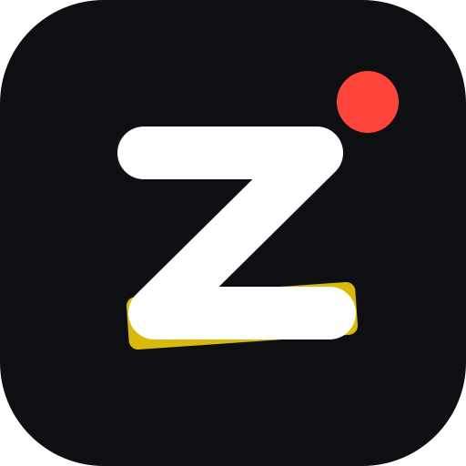
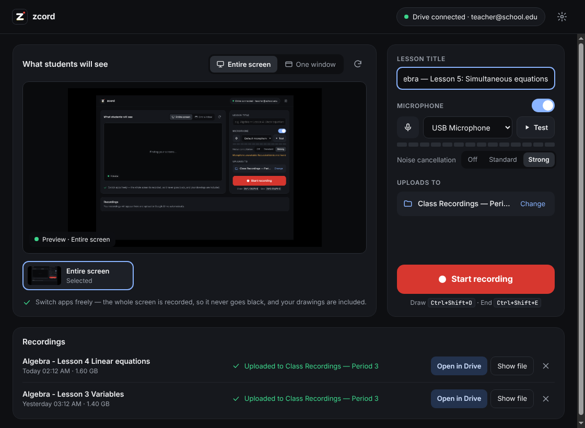
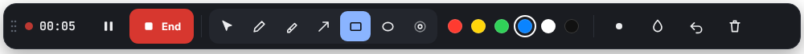

<p align="center">
  
</p>

<h1 align="center">zcord</h1>

<p align="center">
  A free screen recorder for teachers. Record your lesson, draw on the screen, and the video lands in your class Google Drive folder by itself.
</p>

<p align="center">
  <a href="https://github.com/ZiyanNifail/zcord/releases/latest"><b>Download</b></a> ·
  <a href="SETUP.md"><b>Setup guide</b></a> ·
  <a href="#using-zcord">How to use it</a>
</p>

<p align="center">
  
</p>

## What it does

- **Never goes black.** It records your whole screen, so you can switch between slides, the browser and PDFs freely, and the video keeps going.
- **Draw to explain.** Pen, highlighter, arrow, box, circle and a laser pointer, right on top of whatever you're showing. Students see the ink in the video.
- **Uploads automatically.** Click **End** and the recording goes straight into your class recordings folder in Google Drive. If the Wi-Fi drops, it carries on where it stopped.
- **Clear voice.** AI noise cancellation removes fans, air-con, typing and traffic, and **Test** lets you hear yourself before you start.
- **Private.** Everything runs on your computer and uploads with *your* Google account. There are no zcord servers, accounts or tracking.

Works on **Windows**, **macOS** and **Linux**.

## Get started

1. **[Download zcord](https://github.com/ZiyanNifail/zcord/releases/latest)**: the `.exe` for Windows, the `.dmg` for Mac, the `.AppImage` for Linux. Double-click to install.
2. **Follow the [setup guide](SETUP.md)** (about 10 minutes, once). zcord walks you through creating your own free Google key, signing in, and choosing your class folder.
3. **Record.**

Because zcord is a free app that isn't registered with Microsoft or Apple, your computer warns you the first time you open it. The [setup guide](SETUP.md#1-install-zcord) shows how to open it anyway.

## Using zcord

1. Pick **Entire screen**, type a lesson title, and click **Start recording**.
2. A small toolbar appears at the top of the screen. Teach as usual and switch apps freely.
3. To point something out, pick a pen and draw. Click the arrow button (or press `Esc`) to go back to using your apps.
4. Click **End**. The video is saved on your computer and uploaded to Drive. You'll get a notification and an **Open in Drive** button.

<p align="center">
  
</p>

On Windows and macOS the toolbar is **hidden from the recording**, so students only see your screen and your drawings.

### Keyboard shortcuts (while recording)

| Shortcut | Action |
| --- | --- |
| `Ctrl+Shift+D` (`⌘⇧D` on Mac) | Drawing on / off |
| `Esc` | Stop drawing, use your apps |
| `1`–`6` (while drawing) | Pen, highlighter, arrow, box, circle, laser pointer |
| `Ctrl+Shift+Z` | Undo last drawing |
| `Ctrl+Shift+C` | Clear all drawings |
| `Ctrl+Shift+P` | Pause / resume |
| `Ctrl+Shift+E` | End and upload |

The droplet button turns on **disappearing ink**: marks fade after a few seconds, which is handy for quick "look here" moments.

### Microphone and noise cancellation

| Setting | Use it when |
| --- | --- |
| **Strong** (default) | Most rooms. An AI model ([RNNoise](https://github.com/xiph/rnnoise)) removes background noise and keeps your voice. In testing, fan noise dropped by about 40 dB while speech stayed at full volume. |
| **Standard** | You prefer the lighter noise suppression used by video-call apps. |
| **Off** | A good microphone in a quiet room, or you're recording music. |

Click **Test** to record 5 seconds and hear exactly how you'll sound.

### Tips

- Use **Entire screen** rather than **One window**: a minimised window records as black, and drawings aren't part of a window.
- **Two monitors?** Pick the one students should see. The toolbar and drawing layer open there.
- **Computer sound** (videos you play) can be recorded on Windows.
- **Quality** is in Settings. *High* keeps small text sharp, at about 2 GB per hour.
- A copy of every recording stays on your computer in `Videos/zcord Recordings` (you can turn this off in Settings).
- **Several computers?** Settings → **Other computers** saves a setup file, so the next computer only needs **Sign in with Google**. See [SETUP.md](SETUP.md#using-zcord-on-more-than-one-computer).

## Run from the code

You need [Node.js](https://nodejs.org/en/download) (LTS). Clone or download this repository, then double-click:

- **Windows:** `Start zcord.bat`. The first run also adds a **zcord** shortcut to your Desktop.
- **Mac:** `Start zcord.command`
- **Linux:** `start-zcord.sh`

Or use a terminal: `npm install`, then `npm start`. Run the tests with `npm test`.

### Build the installers

- **On GitHub:** push a tag like `v1.2.0`. The **Build installers** workflow builds Windows, Mac and Linux installers and attaches them to a Release.
- **On your computer:** `npm run dist:win`, `npm run dist:mac` or `npm run dist:linux` (output in `dist/`).

Want installers with your Google key and class folder built in, for yourself or your school? See [Making your own pre-configured build](docs/private-build.md).

## Privacy

- zcord talks only to Google (sign-in and Drive). There are no other servers, analytics or tracking.
- Your Google sign-in is stored on your computer only, encrypted by the operating system.
- Noise cancellation and the mic test run on your computer. Audio leaves your computer only as part of the finished recording you upload to your own Drive.
- zcord uses the Google Drive permission only to check your chosen folder and upload recordings into it.

## Project layout

```
src/
  main.js              Electron main process: windows, capture, saving, upload queue
  drive.js             Google sign-in (OAuth with PKCE) and resumable Drive uploads
  store.js             Settings, sign-in and upload-queue storage; the setup file
  preload.js           Safe bridge between the windows and the main process
  assets/              Logo and app icon
  renderer/
    control.*          Main window
    mic.js             Microphone pipeline: noise cancellation, level meter, mic test
    toolbar.*          Floating recording toolbar
    overlay.*          Transparent drawing layer
    vendor/rnnoise/    Noise-suppression model (WebAssembly) and its licences
build/                 Installer icons
scripts/               Desktop shortcut and build helpers
test/                  Tests (fake Google server)
.github/workflows/     Installer builds
```

## License

[MIT](LICENSE). The bundled Inter and JetBrains Mono fonts are under the SIL Open Font License; the noise-suppression components are under MIT, Apache-2.0 and BSD-3-Clause (see `src/renderer/vendor/rnnoise/NOTICE.md`).
